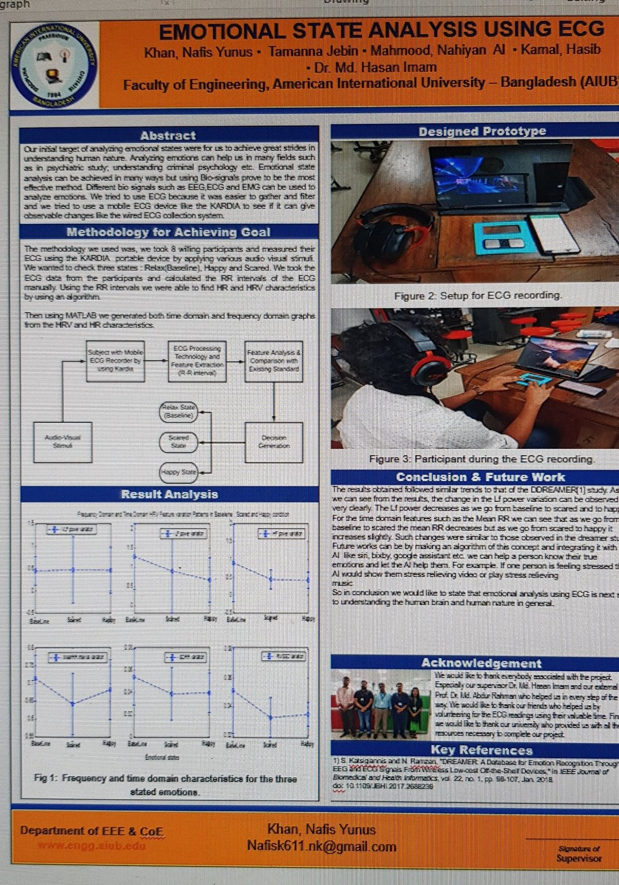
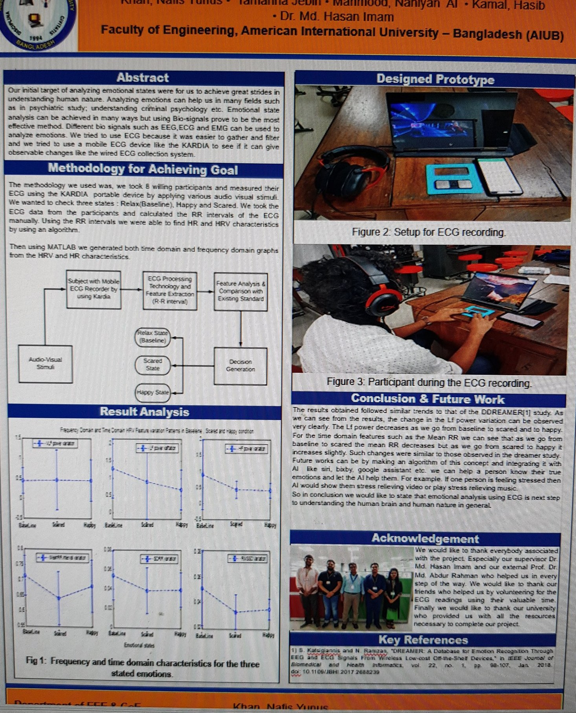

# ECG Signal Acquisition & Emotional State Analysis

B.Sc. capstone project, American International University-Bangladesh (AIUB).

## Overview

Built ECG acquisition circuitry to capture heart signals from portable handheld hardware, then applied signal processing to classify emotional states from the acquired ECG data. The work covers the full chain: analog front-end acquisition, hardware testing and calibration, and software-side feature extraction and classification.

Published as: **"Emotional State Analysis using Portable Handheld Devices"** — IEEE BECITHCON 2020.

## Project poster (AIUB final year)

Final-year group capstone with Nafis Yunus Khan, Tamanna Jebin, and Hasib Kamal, supervised by Dr. Md. Hasan Imam. Method: ECG recorded from 8 participants with a Kardia portable ECG device under audio-visual stimuli; the three states (relaxed/baseline, happy, scared) were analyzed from RR-interval HRV features in MATLAB, with trends compared against the DREAMER study. This work was then extended and published at IEEE BECITHCON 2020.

## What I did

- Designed and built the ECG acquisition circuitry (electrode interface, amplification and filtering for a clean signal)
- Tested, troubleshot, and calibrated the hardware
- Processed the acquired signals and classified emotional states from ECG features

## Skills demonstrated

Analog circuit design · biomedical signal acquisition · hardware testing & calibration · signal processing · technical documentation

## Repository note

This repository holds the project documentation. The original source code was kept on a university lab machine and is not preserved; the design, hardware, and results are documented here.
