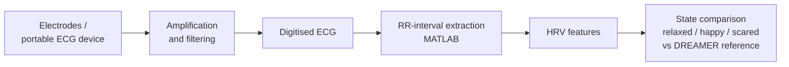

# ECG Signal Acquisition & Emotional State Analysis

B.Sc. capstone project, American International University-Bangladesh (AIUB). Published as "Emotional State Analysis using Portable Handheld Devices", IEEE BECITHCON 2020.

# Overview

This project covers the full measurement chain for ECG-based emotional-state analysis: ECG acquisition hardware designed, built, and tested as the project's hardware work; a participant study in which ECG was recorded under audio-visual stimuli; and MATLAB analysis of RR-interval heart-rate-variability (HRV) features across three states (relaxed/baseline, happy, scared), compared against the published DREAMER study.

One clarification, stated plainly because the two halves are easy to conflate: the acquisition circuitry was designed, built, and calibrated as project hardware. The participant recordings used in the study were captured with a Kardia portable ECG device. Both are part of the project; they are different parts.

# Problem Statement

Can emotional state be inferred, at prototype scale, from ECG-derived HRV features collected with portable hardware? The engineering problem is signal quality and method validity: acquiring a clean ECG, extracting reliable RR intervals, and comparing states without overstating what a small sample supports.

# Objectives

1. Design and build an ECG acquisition front-end (electrode interface, amplification, filtering) and verify it on the bench.
2. Collect ECG recordings from participants under controlled audio-visual stimuli for three target states.
3. Extract RR-interval HRV features in MATLAB and compare state trends against a published reference study (DREAMER).
4. Publish the work (achieved: IEEE BECITHCON 2020).

# Hardware Setup

- ECG acquisition circuitry (project-built): electrode interface, amplification and filtering stages for a clean signal.
- Kardia portable ECG device: used for participant study recordings.
- Project poster (below) documents the setup.

# Software Setup

MATLAB: signal processing, RR-interval extraction, HRV feature computation and comparison across states.

# Architecture

# Methodology

ECG recorded from 8 participants under audio-visual stimuli designed to elicit the three states. RR intervals were extracted from the recordings; HRV features were computed per state in MATLAB and the trends compared against the DREAMER study's findings. The hardware work (design, build, test, calibration of the acquisition circuitry) proceeded as the project's engineering component alongside the study.

# Test Matrix

| Item | Method | Outcome |
|---|---|---|
| Acquisition circuitry | Bench test and calibration | Built and tested (project record: poster) |
| Study recordings | 8 participants, 3 stimulus states | Completed |
| Feature extraction | RR-interval HRV features, MATLAB | Completed |
| Reference comparison | Trends vs DREAMER study | Completed; published |

# Investigation Process

Hardware troubleshooting and calibration of the acquisition circuitry during the build; signal-quality checks on recordings before feature extraction (unusable segments would invalidate HRV features downstream).

# Evidence

- Project poster (2 images, this repository): setup, method, and presentation record.
- Publication: "Emotional State Analysis using Portable Handheld Devices", IEEE BECITHCON 2020.

# Results

The study pipeline was completed end to end: recordings from 8 participants across three states, HRV features extracted, and state trends compared against the DREAMER reference. The work was accepted and published at IEEE BECITHCON 2020. Detailed figures are in the paper and poster; this README does not restate numeric outcomes beyond what those documents show.

# Root Cause Analysis

Not a fault investigation. The analytical risk in this kind of work is measurement validity: HRV features are sensitive to recording quality and segment selection, and emotion inference from HRV is correlational. The method addresses this by fixing the stimulus protocol across participants and benchmarking trends against a published study rather than claiming absolute classification.

# Limitations

- Small sample (8 participants). Findings are trend-level, not clinical or generalisable.
- Source code and raw data are not preserved (kept on a university lab machine). This repository is the documentation record.
- Emotion-from-HRV is an indirect inference; the publication frames it accordingly.

# Lessons Learned

- In measurement projects, the chain is the project: acquisition quality decides everything downstream, and calibration time is never wasted.
- State the hardware story precisely. "Built circuitry" and "recorded with a commercial device" are both true here, and the distinction matters to any careful reader.

# Future Work

- Rebuild the acquisition front-end as a reproducible bench setup with logged test signals.
- Re-run the analysis pipeline on a public HRV dataset to make the software half auditable.

## Team and credit

Final-year group capstone with Nafis Yunus Khan, Tamanna Jebin, and Hasib Kamal, supervised by Dr. Md. Hasan Imam. My contributions: acquisition circuitry design and build, hardware testing and calibration, signal processing and classification work.

## Repository note

This repository holds the project documentation. The original source code was kept on a university lab machine and is not preserved; the design, hardware, and results are documented here and in the publication.
